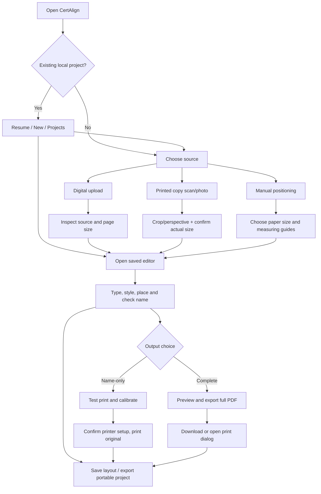
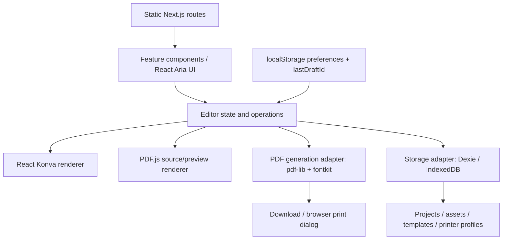

# CertAlign — System Development Plan

**Version:** 1.0 (approved planning baseline)  
**Date:** 2026-10-19  
**Platform:** Responsive, static browser application  
**Primary use:** Add a recipient name accurately to an existing physical or digital certificate  
**Status:** Planning specification; implementation has not begun  

---

## 1. Executive summary

CertAlign is a focused certificate-name placement and printing utility, **not** a general-purpose certificate creator. Users can work from (1) an existing digital certificate, (2) a photograph or scan of a printed certificate, or (3) a blank, dimensioned canvas when no image is available. The same editor supports type, font preview, drag-to-place, precise measurement, and print previews. Output can be **name-only** for printing directly onto an already-printed certificate or a **complete certificate PDF** with the digital background and name combined.

CertAlign v1 operates without accounts or a server database. Processing stays in the browser. Current work and reusable assets persist on the same browser using IndexedDB; small preferences and the most recently opened project ID use localStorage. A portable project export/import mechanism provides manual phone-to-desktop transfer, rather than promising automatic cloud sync.

**Product promise:** “Put a name on an existing certificate—accurately, without learning design software.”

### 1.1 Agreed decisions

| Decision | Baseline |
|---|---|
| Device strategy | Option C: responsive mobile and desktop, desktop optimized for precision and printing |
| Application delivery | Static Next.js App Router export (`output: 'export'`) |
| Main language | TypeScript |
| Styling | Tailwind CSS v4 and semantic design tokens |
| Accessible components | React Aria Components, using the installed version's API |
| Icons | lucide-react exclusively for application icons |
| Editor | React Konva (browser only) |
| PDF viewer | PDF.js (`pdfjs-dist`) |
| PDF output | pdf-lib + `@pdf-lib/fontkit` |
| Storage | IndexedDB via Dexie + lightweight localStorage |
| Authentication/backend | None in v1 |
| Cloud sync | None in v1 |
| Deployment | Vercel or other static host, HTTPS |
| UI design | Restrained, practical, non-generic, document-first, progressive disclosure |

### 1.2 Success criteria

- Someone who has not used a design editor can start, add a name, and reach a printable preview without reading a manual.
- A physical certificate's background is **never** printed unintentionally in Name Only output.
- Printed coordinates originate from real paper dimensions, not screenshot pixels.
- A calibration process offers measurement and correction and warns that printer hardware limits still apply.
- The user can close and reopen the same browser and resume a saved project, where browser storage is available and retained.
- A project can be exported from a phone and imported on a different device without an account.
- Keyboard, touch, and screen-reader users can access all core workflow controls, including numerical positioning if canvas dragging is unsuitable.

---

## 2. Scope and priorities

### 2.1 v1 — required (P0)

1. Start screen with **Digital Copy**, **Printed Copy**, and subtle **No Image / Manual Setup** entry.
2. Upload JPEG, PNG, and supported PDFs; inspect dimensions, orientation, and page count.
3. Take/upload a photo of a physical certificate; provide manual four-corner selection, rotate, perspective straighten, crop, and retake.
4. Confirm actual physical paper dimensions: A4, US Letter, Legal, common custom size; landscape/portrait; millimeters. Photo pixels **cannot** establish actual paper dimensions.
5. Single guided editor: enter a name; see the exact text; choose an included font; drag to position; center horizontally; keyboard/numeric X-Y; zoom and guides.
6. Core text controls: size, supported weight/style, color, letter spacing, alignment, bounding-width warning, undo/redo; name overflow handling.
7. Import compatible custom fonts, with clear embed/licensing warnings and fallback for unsupported formats.
8. Two modes: **Print Name Only** and **Export / Print Complete Certificate**. Suggested default depends on source but can be changed with an explanation.
9. For physical printing: print-ready name-only PDF, correct page size, test sheet, and X/Y calibration offsets, with a final confirmation before using original paper.
10. Autosave projects, resume after reload/browser restart, last opened draft, rename/duplicate/delete, and save a reusable layout.
11. Portable backup transfer: export/import a local project bundle including original asset and configuration. No auto-sync claim.
12. Responsive workflow, loading/error/empty states, keyboard/touch access, and help pages.

### 2.2 v1.1 — valuable enhancements (P1; not launch blockers)

- Automated edge detection and perspective correction (OpenCV.js after manual scan flow proves reliable).
- Advanced character/word spacing or named text styles; optional smarter text width fit.
- Printer profiles for multiple printers and paper feeders (a basic single profile can exist in v1).
- Multiple recipient fields or date/organization placeholders.
- Batch name import via CSV, review, and multi-page export.
- Installable PWA/offline support if the initial load and font assets are fully available offline.
- Improved on-device image quality assessment; optional share-sheet transfers.

### 2.3 Deferred (P2)

- Account system, Supabase, remote storage, real-time cross-device sync.
- Collaborator and organization workspaces.
- OCR/AI blank-name-region detection and font matching.
- Direct hardware printer control, printer discovery, or silent print.
- Automatic QR-based transfer without a separate transfer endpoint/protocol.
- Full Canva-style certificate authoring, signatures/stamps design, or image background editing.

### 2.4 Explicit non-goals

- CertAlign does **not** authenticate the legitimacy of a certificate or provide certification authority.
- It does not modify a physical certificate automatically: users still feed the original sheet into a compatible printer.
- It cannot guarantee identical physical alignment on every printer; print dialogs, non-printable margins, and paper feeding are outside browser control.
- It does not guarantee that all commercial or installed system fonts are legally available or embeddable.

---

## 3. Users and their primary jobs

| Persona | Need | Happy path |
|---|---|---|
| Workshop attendee | Fill name on one printed certificate | Scan/photograph → add name → test → name-only print |
| School/organization staff | Reuse one blank certificate design for multiple recipients | Upload digital → save template → replace name → export full PDF |
| Phone-only user | Capture and begin editing from a phone | Phone camera → crop and size → edit → export PDF or project |
| Phone capture + desktop printer user | Transfer accurate work to printer-connected PC | Phone scan → export project file → transfer file → desktop import → calibrate/print |
| User without digital copy or camera | Measure text placement on paper manually | Choose manual setup → paper size → coordinates/name → test → print |

Accessibility is not a separate persona; all paths need equivalent labeled non-dragging controls.

---

## 4. Information architecture and navigation

### 4.1 Primary routes (all statically exportable)

| Route | Responsibility |
|---|---|
| `/` | Start screen and resume last project / recent work |
| `/editor` | Client-side editor, project chosen via opaque ID in query string or local state |
| `/projects` | Locally saved projects and reusable templates |
| `/settings` | Defaults, printer calibration profiles, storage status, privacy and clear-data actions |
| `/help` | Guided explanations, printing checklist, transfer guide, known limitations |

Avoid runtime dynamic routes like `/editor/[id]` that require unknown server-generated IDs in static export. `?project=<opaque-id>` is acceptable; **never** put recipient names or certificate content in URLs. All browser APIs load only after client hydration.

### 4.2 Navigation rules

- During the wizard, show a small brand link, a 3-stage progress header, Back, and autosave status. **Do not** show a permanent dashboard sidebar.
- Outside the wizard, a compact top navigation is enough: **New**, **Projects**, **Help**, and **Settings**.
- Use real page navigation for large tasks and Modals only for short feature dialogs.
- Show one clear primary action per stage; disable impossible actions with accessible explanations.
- Save progress before navigating backward or changing project.
- Returning users see **Continue editing** and a concise list of recent projects; first-time visitors see start methods.

### 4.3 Main journey map



---

## 5. Detailed end-to-end user flows

### Flow A — New user with a digital certificate

1. At `/`, choose **I have a digital certificate**.
2. Drop or select a PDF/PNG/JPG. Display import progress and a visual preview. On failure explain type, password protection, corruption, or size limits.
3. If the PDF contains multiple pages, show page count and allow selecting a certificate page. In v1 editing applies to the selected target page; the output policy for untouched pages must be clear and tested. For the simplest v1 release, reject unsupported multi-page editing with a helpful message rather than silently dropping content.
4. Confirm paper size inferred from valid PDF page boxes or confirm/override physical size for an image.
5. Editor opens with one centered placeholder text box. User enters recipient name and moves it into the blank area.
6. On **Preview**, show the selected output options with **Complete Certificate** recommended, and **Name Only** available if the user actually wants to print onto an existing paper copy.
7. Preview the generated PDF itself (not only the canvas). Download or print.
8. Save draft automatically; offer **Save as Template** when user finishes.

### Flow B — Only a physical, already-printed certificate exists

1. At `/`, choose **I have a printed certificate**.
2. On mobile choose **Use camera** or **Choose photo**; on desktop also support file upload/scanner-exported file. Use browser camera only with permission and HTTPS; offer `<input type="file" accept="image/*" capture="environment">` as a compatible fallback.
3. Display original photo with four draggable crop corners, rotation, and a **Retake / Choose another** action.
4. Straighten the image by perspective transform. Explain that the preview is a positioning reference only.
5. User explicitly selects/enters **actual paper width and height**; never infer centimeters from a photo alone.
6. Place name in the editor; source image marked **Reference—will not print**.
7. Recommend **Print Name Only**. In preview, show transparent/reference overlay toggle versus real output (white page with only name).
8. User prints a test sheet on plain paper at Actual Size / 100%, physically checks against the original certificate (overlay by holding up to light or careful measurements), enters correction offsets, and re-tests if needed.
9. Once satisfied, the user loads the original certificate into the printer as guided by that printer's paper feed directions and prints the name-only PDF.
10. Save the source, position, printer offset, and layout in the project.

### Flow C — No usable digital/photo reference

1. At start, choose **Set up without an image** (secondary action).
2. Select paper size/orientation and optionally enter custom width and height in millimeters.
3. Provide a blank dimensioned canvas and clear top-left origin ruler guides.
4. User measures the center or target area on the actual certificate using a ruler and enters X/Y measurements; app also allows dragging on the blank canvas.
5. Type name, adjust font, use center/align controls, and print a calibration/test sheet.
6. Name-only output is the default. A complete PDF is simply name on a blank page, so label this honestly and do **not** call it a completed certificate.

### Flow D — Mobile scan → desktop editing / printing (Option C)

1. Scan and straighten the certificate on phone; confirm paper size, edit if desired.
2. Choose **Move project to another device**.
3. Export a `.certalign` portable project package (a ZIP under a custom extension), including project metadata, coordinate data, source image/PDF, compatible custom font bytes if license allows, and format/version manifest.
4. Transfer the file manually via ordinary file sharing, cable, messaging, local transfer utility, or another method chosen by the user. The web app does **not** send the file to its own server.
5. Open CertAlign on desktop and choose **Import project**; validate package and restore a new local project.
6. Re-check the physical paper size and preview the name; printer calibration is *device/printer-specific* and is not assumed to transfer unchanged.
7. Test/print from desktop. Export a backup for future portability.

### Flow E — Resume, save, and reuse

1. An edit is debounced and saved with status: Saving… → Saved locally (or Error—download backup).
2. Reloading `/` offers **Continue editing** if the referenced project still exists.
3. `/projects` lists projects with name (user-set label), source type, paper size, last edited, and thumbnail where safe.
4. Actions: Open, Duplicate, Rename, Save layout as template, Export project, Delete (confirmation).
5. Applying a template loads its text placement/style and calibrated page dimensions; recipient name can be replaced without rearranging the layout.
6. Deleting source assets warns when templates or projects still refer to them.

### Flow F — User cancels, encounters error, or chooses wrong source

- Provide Back and **Change source** while retaining the unsaved current draft as appropriate.
- Do not surprise users by resetting the name, chosen font, or paper size.
- Confirm only genuinely destructive actions (Clear all data, Delete project, Replace source if geometry changes).
- If camera permission fails, show **Upload photo instead**.
- If IndexedDB is unavailable/full, let the user continue temporarily and export a project file immediately.
- If the browser does not support a required font/PDF feature, explain the unavailable action and provide supported alternatives.

---

## 6. Product feature specifications

### 6.1 Input and import

**Required:** Drag/drop and browse for PNG/JPG/PDF; camera image; orientation fix; thumbnail; clear import errors; PDF password/invalid-file handling. Validate extension **and** magic bytes/actual decoding, size, dimensions, and supported page count. Do not set an arbitrary hidden 5 MB limit: adopt documented adjustable file caps after browser-performance testing.

**Import rules:** Preserve original file binary in IndexedDB, separately from normalized preview bytes. Respect EXIF orientation. Allow image rotation, crop and perspective correction without irreversibly discarding the original. PDF pages may have rotation/crop boxes; transform preview-to-document coordinates correctly.

### 6.2 Certificate editor

- Main canvas shows paper page, certificate reference, editable name, page guides, and non-printing selection handles.
- Default add-name flow places a text box centered on the page, not over a guessed blank region. Users can click a blank region or drag.
- Support text entry in a real accessible HTML input alongside visual Konva canvas.
- Font picker uses **React Aria ComboBox** because it needs search; ordinary fixed choices use shared Select.
- Controls: font family, supported style/weight, size, line alignment, color, letter spacing, text-box width, text position X/Y (mm); optional rotate and multiline only if justified by certificate cases.
- Long names: text box indicates overflow and offers **Fit name to width** with preview; never silently truncate the printed name.
- Preview has zoom-to-fit, 100%, pan, drag/keyboard nudge, center on page, grid/ruler toggle; panning does not change print geometry.
- Undo/redo for user edits including placement, type styling, and text content.
- Changes update a single canonical project model; canvas node state must be committed after drag/transform.

### 6.3 Fonts

- Curate a useful range of legally redistributable serif, sans, script, and formal fonts; do not claim “all fonts.”
- Search fonts by name and category, preview using the actual entered recipient name.
- Use the *same source font metrics* for preview and PDF export wherever possible; treat mismatches as bugs.
- Bundle/host fonts needed for basic operation as static assets; third-party remote fonts may create a network dependency or font-loading disclosure.
- Custom uploads: start with TTF and supported OTF; accept WOFF2 for preview only unless converted through a verified licensed/compatible pipeline. Show unsupported font/embedding errors instead of silently substituting.
- Respect font licensing; embed only when permitted. Keep custom font assets local.
- Test accent marks, multiword names, punctuation, special Unicode characters, and known font-script coverage. Unsupported glyphs must trigger warning/fallback review.

### 6.4 Print modes

| Mode | Contents | Primary situation |
|---|---|---|
| **Name Only** | Only recipient text and any explicitly added printable text; **no background/reference, crop handles, guides, or registration marks** on final PDF | Original physical certificate is already printed |
| **Complete PDF** | Original imported digital page/background plus positioned text | User wants to print/download whole certificate |
| **Calibration Test PDF** | Temporary guides/targets, labels and/or name used only to check positioning; **not** final output | Physical-print checking |

The default print choice may be derived from source mode, but both useful options remain discoverable. Never mix calibration marks into production output. Generate final output using PDF coordinates from paper dimensions; do not export the rendered editor canvas as a low-quality screenshot.

### 6.5 Physical print calibration

- Paper size, orientation, and printer printable-area caveat displayed before printing.
- A step-by-step checklist: select correct paper, disable scaling/choose Actual Size, print on ordinary paper, compare alignment, measure horizontal/vertical offset, apply correction, retest, then feed original.
- Show correction in mm; positive X = move right, positive Y = move down, relative to the chosen page reference.
- Save offset with a named local printer profile where supported; identify that browser cannot automatically verify which hardware printer is selected.
- Final page preview has a clear switch **Show certificate reference (preview only)** and **Show actual printed output**.
- Check name is inside paper dimensions, not necessarily inside an unknowable printer printable area; warn about likely edge clipping and test on the chosen printer.
- Print action opens/downloads PDF and relies on user/printer dialog; do not promise silent or automatic printer selection.

### 6.6 Templates and projects

- **Project:** a working certificate instance containing source, recipient name, text geometry, style, output selection, page size, revision and save timestamps.
- **Template:** a reusable layout, paper settings and reference asset designed to be filled with different names. Avoid carrying a real recipient name into newly applied templates by default.
- Recent projects show safe generated thumbnails; storage local-only messaging visible.
- Export/import `.certalign` versioned packages. Define a migration strategy for older packages; reject unknown future versions safely.
- Import of a `.certalign` file must never execute scripts, trust paths, inject arbitrary HTML, or write outside the browser's managed data.

---

## 7. UI/UX specification

### 7.1 Visual character

The interface should feel like a small, reliable document utility: generous whitespace, restrained color, crisp type, subtle borders, no decorative gradients, no stock illustrations, no giant emoji icons, and no excessive cards/shadows. Certificate artwork is **user-provided**, not invented by the interface.

Suggested initial tokens (subject to visual review):

| Role | Token | Candidate value |
|---|---|---|
| Page | `--background` | `#FAFAF8` |
| Surface | `--surface` | `#FFFFFF` |
| Text | `--foreground` | `#1F2937` |
| Muted text | `--muted-foreground` | `#64748B` |
| Border | `--border` | `#E4E7EC` |
| Primary | `--primary` | `#355F8C` |
| Focus | `--focus` | Accessible stronger outline derived from primary |
| Danger | `--danger` | `#B42318` |
| Accent | `--accent-muted` | `#B89A63` sparingly, not a general highlight |

- UI type: one system/Geist-like readable sans family; certificate font selection is independent.
- Reusable spacing and control-size scale. No fixed-width controls that overflow mobile.
- Consistent 16–20 px Lucide icons; labels accompany important actions.
- Light mode first; dark mode not a v1 requirement unless explicitly requested.
- Use motion only for clear status changes and respect reduced-motion settings.

### 7.2 Screen composition

**Home (desktop):** small top header; main heading “Add a name to your certificate”; short explainer; two equal primary source choices, and a low-emphasis manual link. If drafts exist, show a slim **Continue where you left off** card above the new-start actions. No marketing homepage before getting work done.

**Editor (desktop):** top compact header with breadcrumbs/back, Prepare › Edit › Print, autosave state, Preview/Next; center region contains large fit-to-view certificate canvas; right inspector has only **Name**, **Font**, **Size**, **Color**, **Alignment** and **Position**. Additional spacing and precision options behind **More controls**. Do not show Save Template as a competing primary action.

**Editor (mobile):** full-width paper preview with zoom/pan; sticky bottom sheet or tabbed controls **Name / Style / Position**; keep Next reachable. Numerical controls must be usable without pixel-perfect dragging. Provide image-photo upload even when live camera isn't available.

**Print stage:** a large preview, a clear explanation of what will actually print, source-aware default, and one primary **Download PDF / Print** action. Name Only mode goes through Test → Adjust → Final; Complete PDF mode goes directly to review/download with optional print. Don't force calibration on digital downloads.

**Projects:** simple list/grid switch as needed, no heavy admin dashboard. Search project labels, show last edited and source type, and expose actions in a proper Menu (not Select).

**Settings:** default page size/units, saved printer offset(s), storage usage, manage local data, export backup, and privacy explanation. Do not require settings before first use.

### 7.3 Wording and progressive disclosure

Prefer “I have a printed certificate,” “Take a photo,” “Choose the actual paper size,” “Move the name,” “Test on plain paper,” and “Print just the name.” Technical concepts like homography, crop matrix, embedded font, and X/Y calibration belong in help/advanced settings.

Every stage should answer three questions: *What am I doing? What do I do next? Can I undo or change it?*

### 7.4 Accessibility

- React Aria for input/select/combobox/menus/modals, keyboard navigation, focus management, and screen-reader names.
- Labeled coordinate inputs and keyboard nudging are an **accessible alternative** to canvas-only drag interactions.
- 44px-ish comfortable mobile touch targets where practical, readable contrast, visible focus, logical tab order, no hover-only actions.
- Status announcements for autosave, validation errors, and generated PDF results.
- Do not rely only on green/red color or icon shape to convey status.

---

## 8. Static client-side architecture

### 8.1 Technical layers



All asset parsing, rendering, fonts, serialization and PDF output happen in the browser. Dynamic imports isolate browser-only libraries from static build prerendering. Use `'use client'` at the smallest necessary components and defer `window`, `navigator`, camera, canvas, localStorage, and IndexedDB operations until mounted.

### 8.2 Canonical coordinate and rendering model

**Single source of truth:** store print geometry in **millimeters**, top-left paper origin, independent of viewport zoom. For example:

```ts
// Illustrative schema only; validate runtime data with Zod.
type Paper = { widthMm: number; heightMm: number; orientation: 'portrait' | 'landscape' };
type NameLayer = {
  text: string;
  xMm: number; yMm: number; // top-left of a defined layout box
  widthMm: number;
  fontAssetId: string;
  fontSizePt: number;
  align: 'left' | 'center' | 'right';
  color: string;
  letterSpacingPt: number;
};
type OutputMode = 'name-only' | 'complete';
```

For preview at `pxPerMm`, transform `xPx = xMm * pxPerMm` and `yPx = yMm * pxPerMm`; zoom affects preview only. Standard PDF user coordinates use 72 points/inch, so `pt = mm * 72 / 25.4`; translate from top-left model to PDF bottom-left coordinates using actual page height **and font baseline/ascent metrics**, not simply flipping the point at the top of the text. For rotated/source PDF pages, apply page rotation and page-box transformations correctly.

**Critical invariant:** drag, numerical editing, preview, save/reopen, and PDF export must preserve the same physical position. Define text-box anchor, baseline and alignment once. Use font-based width measurement and glyph metrics for PDF placement, not Konva's approximation alone.

### 8.3 PDF handling decisions

- **PDF.js** loads source PDF for page preview; package its worker as a local, version-compatible static asset and verify build output path.
- **pdf-lib** handles existing-page PDF modifications where supported and generates new name-only PDFs with correct page boxes.
- Use `@pdf-lib/fontkit` for supported custom font embedding; test real formats and glyphs.
- If the source is PNG/JPEG, place original raster at correct aspect ratio in a PDF of confirmed paper dimensions before drawing name.
- For source PDF, prefer retaining original page/vector content instead of rasterizing, subject to tested PDF compatibility.
- Generated PDF is the authoritative print preview. Users may zoom PDF without changing printed dimensions.

### 8.4 Imaging decisions

- Cropping/perspective correction is image-processing logic, not React Aria widget logic.
- Start with manual four-corner crop and transform in browser canvas/OpenCV only as necessary; automatic edge detection can be added later.
- Keep original and corrected preview as separate assets or reproducible transform metadata.
- Reconcile crop rectangle/rotation with actual paper dimensions before converting a screen click to mm.

### 8.5 No server assumptions

Do not create route handlers, server actions, middleware, SQL schemas, backend auth, service-role keys, or remote asset upload endpoints. Never put PDFs or participant names into query strings, analytics payloads, error reporting, or third-party URLs.

---

## 9. Browser data storage and continuity

### 9.1 Storage separation

| Location | What to store | Why |
|---|---|---|
| React state | Active interaction state, selection, pointer position, modal state | Fast temporary UI state |
| `sessionStorage` (optional) | Tab-only transient wizard details | Only when tab isolation is actually useful |
| `localStorage` | `lastProjectId`, UI preferences, last chosen page unit, onboarding seen | Tiny values; persistent across reloads |
| IndexedDB via Dexie | Projects, templates, source PDF/images, corrected preview assets, compatible font blobs, printer calibration profiles | Structured, larger files and persistent drafts |

No claim that this data is synchronized to another device. Browser retention is best-effort and may be lost when site data is cleared, private mode ends, quota eviction occurs, or the origin/domain changes. Use `navigator.storage.estimate()` to report usage and `persist()` as a best-effort option (never assume it is granted).

### 9.2 Suggested IndexedDB tables

```text
projects
  id, label, schemaVersion, sourceMode, sourceAssetId,
  paper, nameLayer, outputPreference, createdAt, updatedAt

assets
  id, projectId?, kind, mime, fileName, byteLength, blob,
  optional dimensions / PDF page metadata

templates
  id, label, sourceAssetId?, paper, reusableNameLayerStyle,
  defaultTextAnchor, createdAt, updatedAt

printerProfiles
  id, userLabel, paperSizeKey, offsetXMm, offsetYMm,
  notes, testedAt?, updatedAt
```

Indexes should support recent-project sorting and asset lookup. All persisted records require versioned Zod validation; use Dexie migrations when schema evolves. Don't create database-like repositories for every trivial React state value.

### 9.3 Autosave and recovery

- Save after a short debounce of meaningful changes and immediately on completed file import/export-related state changes.
- Serialize the canonical mm geometry—not Konva node instances or DOM elements.
- Display explicit status: **Saving**, **Saved locally**, **Storage unavailable**, **Storage full**.
- On save failure, never falsely report success; offer **Download portable project** immediately.
- Only update `lastProjectId` after successful project creation; handle stale/missing IDs cleanly.
- Resume with clear choice **Continue**, **New**, **Projects**. Avoid reopening the user into a stuck modal.
- Support explicit **Delete this project**, **Clear all local data**, and **Export backup** with confirmations appropriate to their impact.

### 9.4 Portable `.certalign` package

Recommended structure (versioned ZIP; contents validated after import):

```text
manifest.json              # format version, app version, checksum info
project.json               # validated dimensions, styles, text coordinates
assets/source.pdf           # or original image
assets/preview.png          # optional corrected image
assets/fonts/font-1.ttf     # optional, only where permitted
```

Use normalized filenames inside ZIP, cap decompressed bytes, block path traversal (`../`), validate magic bytes and manifests, and warn on files needing unsupported font substitution. Avoid importing arbitrary JavaScript/HTML. Export a regular PDF separately; a `.certalign` file is for **continuing editing**, not for direct printing.

### 9.5 Privacy promise

In v1, application code should not upload user files to a CertAlign server. Static hosting still delivers site resources and may log visits. Remote fonts, CDN assets, analytics, or crash reporting could make network calls; prefer locally hosted assets and disclose optional services. Provide a concise privacy note that locally saved files are accessible to someone who uses the same browser profile/device.

---

## 10. Applying the user's uploaded development rules

These rules come from the user's supplied Select, Modal, Alert Dialog, Next.js architecture, TypeScript, and Tailwind guidelines. The static-app adaptations below are project-specific decisions, not source-document claims.

### 10.1 React Aria Select — canonical shared primitive

Follow the uploaded shared-select rules:

- Inspect for an existing implementation before creating another; create `src/components/ui/select/Select.tsx` only if none exists.
- Shared Select controls trigger, selected value, chevron, popover, listbox, check, focus/disabled behavior, and accessibility; **feature** owns options, filtering meaning, and state.
- Trigger and popover width match using the supported React Aria trigger-width CSS variable; avoid arbitrary duplicate widths.
- Selected option stays visible and checked, long options scroll, normal labels don't truncate due to careless flex squeezing.
- Select is for **choices** (paper sizes, print mode where a dropdown makes sense); use **Menu** for “Open / Rename / Delete”; use **ComboBox** for a searchable font library.
- Follow the installed `react-aria-components` version; don't copy outdated APIs blindly.

### 10.2 Modal — standard information/form dialog

- Inspect before creation; use one canonical `src/components/layout/modal/Modal.tsx` when needed.
- Dynamic title left and labeled X close right; fixed/non-scrolling modal header; only body scrolls.
- Max height within viewport; feature-controlled widths; React Aria handles focus containment, Escape policy, and dialog semantics.
- Contents supplied by feature (e.g., paper dimensions form, font import form); no business logic in shared modal.

### 10.3 Alert Dialog — deliberate confirmations

- Separate canonical `src/components/layout/alert-dialog/AlertDialog.tsx` if absent.
- Use proper alertdialog semantics, title, description, Cancel/Confirm, pending state, and appropriate destructive treatment.
- Do not add X by default; avoid accidental outside-click dismissal for high-impact confirmations.
- Feature determines action and wording; component provides consistent presentation and access behavior.
- Appropriate uses: Delete project, Replace current source if layout may shift, Clear all browser data.

### 10.4 Tailwind and design-system rules

- Tailwind is the single primary styling system; no parallel CSS-in-JS/theme frameworks.
- Tailwind v4 tokens in global `@theme` stylesheet, semantic utilities (e.g., `bg-background`, `border-border`, `text-foreground`).
- `className` for static styles; `cn()` for conditional classes; CVA only for meaningful repeated component variants. Keep CVA beside its component.
- Inspect/reuse existing Button, Input, Dialog, Select before adding duplicates. Button owns presentation but no certificate business rules.
- Mobile-first standard breakpoints, visible focus, contrast, disabled states, reduced motion, no hover-only cues.
- Page composition and feature-local styles stay near their owners; avoid needless wrappers and `index.ts` proliferation.

### 10.5 TypeScript, errors, and layering

- Validate runtime data from uploaded files, IndexedDB, imported packages, and user settings using Zod; TypeScript types do not validate untrusted bytes.
- Prefer typed expected-error codes and user-safe error messages (e.g., `UNSUPPORTED_PDF`, `STORAGE_QUOTA`, `INVALID_FONT`, `CAMERA_PERMISSION_DENIED`).
- Small architecture profile: routing → feature UI/operations → browser-native adapters, with reusable pure measurement/PDF operations where there are real rules.
- Do **not** add Services/Repositories/API clients solely to satisfy an enterprise folder hierarchy; local Dexie access can be a clearly scoped storage adapter.
- Before replacing existing components/folders, inspect reuse, do one representative migration, verify, and remove obsolete duplicates only when unused.

---

## 11. Recommended file structure

```text
certalign/
├── public/
│   └── fonts/                    # bundled legally licensed fonts
├── src/
│   ├── app/
│   │   ├── layout.tsx
│   │   ├── page.tsx               # start + local resume
│   │   ├── editor/page.tsx        # static route; project ID client-side
│   │   ├── projects/page.tsx
│   │   ├── settings/page.tsx
│   │   ├── help/page.tsx
│   │   └── globals.css           # Tailwind v4 @theme and global behavior
│   ├── components/
│   │   ├── common/Button.tsx      # shared React Aria button, CVA if needed
│   │   ├── ui/select/Select.tsx
│   │   ├── ui/font-combobox/FontComboBox.tsx
│   │   ├── layout/modal/Modal.tsx
│   │   ├── layout/alert-dialog/AlertDialog.tsx
│   │   └── layout/               # only reusable layout pieces required
│   ├── features/
│   │   ├── start/                # source choice / onboarding
│   │   ├── import/               # file processing and validation
│   │   ├── scanning/             # camera, crop, perspective
│   │   ├── editor/               # canvas, editor state, inspector
│   │   ├── fonts/                # font registry, validation, preview
│   │   ├── printing/             # PDF export and calibration UI
│   │   ├── projects/             # local project management
│   │   └── templates/            # reusable layouts
│   ├── lib/
│   │   ├── storage/              # Dexie definition, validation, migrations
│   │   ├── pdf/                  # PDF.js / pdf-lib adapters
│   │   ├── geometry/             # mm, pt, transforms, anchors
│   │   ├── images/               # crop/perspective utilities
│   │   ├── project-package/      # zip export/import
│   │   └── cn.ts
│   └── types/                    # genuinely cross-feature types
├── tests/
│   ├── unit/
│   ├── integration/
│   ├── e2e/
│   └── fixtures/                # synthetic non-sensitive test certificates
├── next.config.ts
├── package.json
└── README.md
```

Prefer feature-level colocated components when generic reuse isn't demonstrated. No premature barrel files, extra business-layer folders, or global store by default. If editor state becomes complex, use a feature-local reducer/store with explicit operations rather than automatic global Zustand adoption.

### 11.1 Example static Next.js config

```ts
import type { NextConfig } from 'next';

const nextConfig: NextConfig = {
  output: 'export',
};

export default nextConfig;
```

Choose static-friendly image usage; the default Next image optimizer requires a server unless adjusted. Verify third-party libraries don't access `window` at build/prerender time.

---

## 12. Development roadmap and definition of done

No calendar commitments are assumed; phases are dependency-based. **Do not proceed to full styling polish before print geometry works.**

### Phase 0 — Foundation and prototype risk spike

**Build:** repository, static export, TypeScript strict, lint/format/test tooling, Tailwind tokens, React Aria button/select, Lucide, sample certificate fixtures. Prove: local image/PDF can render and a PDF with a name can be generated at physical dimensions.

**Exit criteria:** `next build` emits static `out/`; deployment can serve it; a name-only PDF generates without server calls; selected font displays and exports for a test case; 1 mm coordinates are consistent in PDF metadata/geometry.

### Phase 1 — Input and preparation

**Build:** home choices; PNG/JPEG/PDF import; camera/photo upload with fallback; scan manual crop/rotate/perspective; paper size and orientation; manual mode; errors and document-size limits.

**Exit criteria:** all three starts lead to a project model with correct dimensions and source metadata; unsupported input fails clearly; original asset preserved.

### Phase 2 — Certificate editor

**Build:** Konva layer, accessible name input, font ComboBox, text styling, mm position fields, centered alignment, drag/nudge, overflow indicator, fit-to-width, undo/redo, responsive inspector.

**Exit criteria:** user can place a name using mouse, touch, or keyboard; zoom doesn't alter physical coordinates; long names aren't silently cropped.

### Phase 3 — Production PDF and calibration (critical gate)

**Build:** preview PDF, name-only output, complete output, font embedding, output-mode labels/defaults, calibration test sheet, offset correction, print help and checks.

**Exit criteria:** background is absent from name-only output; complete digital PDF includes original plus correctly placed name; test print and correction work on actual hardware; scaling warning present.

### Phase 4 — Persistence and project transfer

**Build:** Dexie stores, autosave/recovery, Projects UI, templates, local printer profiles, `.certalign` ZIP export/import, deletion/clear confirmations, storage warning, fallback on quota failure.

**Exit criteria:** reload/restart retains source and position; project can transfer phone-to-desktop; local storage error never falsely shows “Saved.”

### Phase 5 — Accessibility, responsive, and release QA

**Build:** polish states, browser/mobile testing, performance optimization (dynamic imports/worker tasks), privacy/help copy, WCAG-oriented keyboard/focus checks, final print matrix, release notes.

**Exit criteria:** end-to-end acceptance matrix passes on required browsers/devices and at least two physical printer configurations where available; no server API dependency; static production build succeeds.

### Phase 6 — Optional enhancements after validation

Evaluate automatic detection, CSV bulk operations, smarter font matching, PWA, multiple saved calibration profiles, and cloud offerings only after observing real workflow issues.

---

## 13. Testing strategy

### 13.1 Test layers and tools

- **Unit tests:** Vitest for mm↔pt/pixels, transform math, text measurement helper policy, Zod schemas, IDs, typed errors, package validation.
- **Component/integration:** React Testing Library for form state, React Aria focus/selection, wizard navigation, autosave status, modal vs alert dialog behavior.
- **End-to-end:** Playwright for browser flows, local persistence, static-hosted page navigation, PDF download, keyboard-only path, mobile emulation.
- **PDF structural tests:** inspect PDF page MediaBox/page count/text/font embeds/background absence, render output to images and compare positions against reference fixtures (with tolerances).
- **Manual hardware tests:** multiple printers and paper types; compare actual printed position with a millimeter ruler after calibration.

### 13.2 Functional acceptance matrix

| ID | Scenario | Expected |
|---|---|---|
| F01 | Start from valid PNG/JPG | Preview and paper size confirmation shown |
| F02 | Start from supported PDF | Page renders; print export retains usable source content |
| F03 | Camera denied | Upload-photo fallback remains available |
| F04 | Crooked camera photo | User can rotate/crop/correct corners without losing original |
| F05 | Manual setup | Blank measured page usable without source file |
| F06 | Change paper size | Geometry is consistently transformed/confirmed; no unnoticed print offset |
| F07 | Long name | Visible fit/overflow handling, no silent text cut-off |
| F08 | Custom supported font | Preview and PDF match and font is embedded where licensed |
| F09 | Unsupported font/glyph | Clear warning; no silent substitution |
| F10 | Name-only export | Source image, crop handles, guides absent in PDF |
| F11 | Complete PDF export | Source background and name both appear at intended coordinates |
| F12 | Calibration test export | Temporary guides appear only on test PDF |
| F13 | X/Y correction | Positive and negative offset directions work as documented |
| F14 | Autosave/reload | Recent project restores source, name, layout, and settings |
| F15 | IndexedDB blocked/quota | Honest error and immediately usable project export option |
| F16 | Export/import project package | Same paper dimensions, source and text position on second device |
| F17 | Delete/clear data | AlertDialog confirms; operation is complete and reflected in UI |
| F18 | Static deployment | Direct and internal navigation to all routes works without backend |
| F19 | Offline after first visit | Only guaranteed if explicitly supported/tested; otherwise friendly unavailable state |
| F20 | Keyboard-only editing | User can set name, font, position, export without dragging |

### 13.3 PDF/geometry cases

- A4 portrait/landscape, US Letter portrait/landscape, and custom size, including 4x6 in and non-standard certificate sizes.
- Coordinates 0 mm, center, near-safe-margin, and with offsets; page rotation and image crop transforms.
- Font metrics: serif, sans, script, custom TTF/OTF, accented letters, variable lengths and punctuation.
- Digital source preserved as vector where supported; compare resolution/text readability to original.
- Zoom 50%, 100%, 200% yields identical PDF placement.
- Export/import and resume cause **no drift** beyond agreed numerical rounding.
- Print a standard 10 mm reference square to check printer scaling and page feed orientation; any mismatch is surfaced in setup instructions.

### 13.4 Physical printer acceptance

Hardware-validated positioning target: strive for approximately **±1 mm on a specific calibrated printer/paper feed** where feasible. This is a **test goal**, not a universal guarantee. Record deviations, paper type, printer, driver scale settings, and repeated-feed variance. If the test repeatedly drifts, provide guidance and never claim printer-perfect accuracy.

### 13.5 UI/accessibility matrix

- Browser: current Chrome/Edge desktop, Firefox desktop, Safari desktop where accessible; mobile Safari and Chrome/Android.
- Viewports: ~320–390 px phone, tablet, laptop, desktop. No horizontal scrolling on primary screens.
- React Aria Select: trigger matches popover width; checks show; long menus scroll; keyboard and disabled states work.
- Modal: sticky header, scrollable content, reachable close. AlertDialog: semantics, focus, deliberate confirmation.
- Reduced motion, visible focus, screen reader labels, errors announced, zoom at 200%, logical tab order.
- Performance: large PDFs/images don't freeze the tab indefinitely; present progress, cancellation, safe limits, and fallbacks.

### 13.6 Quality gates per phase

Run `lint`, `typecheck`, `unit tests`, integration/E2E appropriate to the phase, and `build`. Fix issues caused by the work, then document any intentional limitations before proceeding. The print gate must include a **real physical print test**, not only screenshots.

---

## 14. Security, privacy, and resilience

- Imported certificate files, ZIP projects, and fonts are **untrusted data**. Decode/parse defensively; validate actual file contents, size, decompression ratios, manifest structure and numeric bounds.
- Limit very large PDFs, canvases, page counts, and image dimensions to avoid browser crashes. Communicate caps rather than failing silently.
- PDFs can contain complex structures; keep PDF.js and pdf-lib patched and do not execute embedded document actions or scripts.
- Prevent ZIP path traversal, oversized decompression, duplicate/conflicting IDs, and unsanitized project labels injected as HTML.
- Use `<canvas>`/PDF viewers for document content; user-supplied text rendered as text, not HTML.
- Handle denied camera/storage permissions, quota exceeded, aborted import, invalid font, PDF parsing errors, and browser download failures.
- Do not place user names, certificate images, or content in telemetry; avoid external analytics by default.
- Warn that anyone sharing the same browser profile can access locally saved certificates; provide clear deletion controls.
- Maintain transparent copy: “Files are processed in your browser; your browser may delete local data. Download a backup for important work.”

---

## 15. Product decisions and dependencies to protect

1. **Physical size must be confirmed for photos.** Cropping an image does not reveal its physical size.
2. **Exact printing originates from a canonical mm model.** Canvas pixels are visualization only.
3. **Name-only mode does not include reference artwork.** A source/background visibility setting must not accidentally change this.
4. **The real PDF is previewed before download/print.** It is the authoritative output.
5. **Printer profile ≠ automatic printer detection.** Hardware/printer settings remain the user's responsibility.
6. **Browser persistence ≠ server session.** Data survives when same-origin storage is retained; it does not automatically follow the user to another device.
7. **Cross-device transfer is explicit file export/import.** Do not market it as automatic synchronization.
8. **Font preview and PDF font embed need a compatible font pipeline.** “Google Fonts” by itself does not guarantee PDF embedding format or matching metrics.
9. **React Aria handles accessible widgets, Konva handles graphical editing.** They do not replace one another.
10. **Keep the guided flow more prominent than the project-management interface.** CertAlign is a focused utility.

---

## 16. Initial delivery backlog (implementation tickets)

| Ticket | Description | Dependencies | Priority |
|---|---|---|---|
| CA-001 | Initialize static Next.js / TypeScript / Tailwind theme and CI checks | None | P0 |
| CA-002 | Implement shared React Aria Button, Select, Modal, AlertDialog and font ComboBox only as required | CA-001 | P0 |
| CA-003 | Define Zod project/paper/name schemas + geometry utilities | CA-001 | P0 |
| CA-004 | Import image and PDF with browser-safe viewer | CA-003 | P0 |
| CA-005 | Printed-copy camera/photo + manual corner adjustment | CA-003, CA-004 | P0 |
| CA-006 | Paper size confirmation and no-image manual entry | CA-003 | P0 |
| CA-007 | Konva editor with drag/numeric placement and basic typography | CA-002–006 | P0 |
| CA-008 | Curated font registry, licensed font assets and PDF embedding | CA-007 | P0 |
| CA-009 | Generate actual Name Only and Complete PDFs | CA-003, CA-004, CA-008 | P0 |
| CA-010 | PDF-based preview, test sheet, print calibration, printer checks | CA-009 | P0 |
| CA-011 | Dexie persistence, autosave, resume, projects | CA-003, CA-007 | P0 |
| CA-012 | Templates and portable `.certalign` package transfer | CA-011 | P0 |
| CA-013 | Mobile UX, keyboard access, help text and errors | CA-002–012 | P0 |
| CA-014 | Browser/PDF/hardware printer QA and static production deployment | All P0 | P0 |
| CA-015 | Automatic edge detection | CA-005 and field feedback | P1 |
| CA-016 | CSV batch and multiple recipients | CA-009, CA-012 | P1 |

### 16.1 Recommended build order

Start with **CA-003 + CA-009 proof of geometry** before investing heavily in the UI: if millimeter-to-PDF placement and font metrics are unreliable, beautiful screens will not solve the user's real problem. Then implement source flows, guided editor, print calibration, persistence, and final polish.

---

## 17. Definition of MVP release ready

All items below must be true:

- [ ] One-page PNG/JPG/PDF digital certificate import works within documented limits.
- [ ] Physical certificate can be photographed/imported, manually straightened, and dimensioned.
- [ ] Manual no-image positioning works.
- [ ] User can enter, preview, style and adjust a name with pointer, touch and keyboard/numeric controls.
- [ ] Same canonical geometry powers editor, test PDF, and final PDFs.
- [ ] Name Only PDF contains **no certificate background**.
- [ ] Complete PDF contains the certificate background and name.
- [ ] Font embedding tests pass for built-in supported fonts and supported uploads.
- [ ] Printer calibration and test-sheet workflow documented and tested with hardware.
- [ ] Local autosave/recovery survives browser restart where storage is retained.
- [ ] Phone-to-desktop export/import restores project data correctly.
- [ ] No backend, login, remote data upload, or unsupported static Next.js feature.
- [ ] Shared Select / Modal / AlertDialog obey supplied rules, without duplicate generic primitives.
- [ ] Main paths pass responsive, accessibility, browser, error and static-build tests.
- [ ] Privacy/limitations, backups, and print instructions are clear.

---

## 18. References and provenance

### User-provided implementation rules (authoritative for this project)

- `shared-react-aria-select-prompt.md` — Select inspection, standardization, responsiveness, width/selected behavior.
- `shared-react-aria-modal-prompt.md` — canonical modal, fixed header, focus, feature content.
- `shared-react-aria-alert-dialog-prompt.md` — confirmation semantics, deliberate cancel/confirm, pending and errors.
- `architecture.md` — Next.js small/medium/large layering and avoiding unnecessary data layers.
- `architecture(1).md` — Tailwind ownership, layout composition, file structure.
- `patterns.md` and `errors.md` — TypeScript runtime validation and typed errors.
- `tokens.md`, `responsive.md`, `components.md`, `definition.json` — semantic Tailwind tokens, mobile-first access, components and styling profile.

### External documentation checked for implementation feasibility (2026-10-19)

- Next.js static export: https://nextjs.org/docs/app/guides/static-exports
- React Aria ComboBox: https://react-aria.adobe.com/ComboBox
- React Aria Popover: https://react-aria.adobe.com/Popover
- Konva React drag & drop: https://konvajs.org/docs/react/Drag_And_Drop.html
- pdf-lib PDFDocument and fontkit: https://pdf-lib.js.org/docs/api/classes/pdfdocument
- pdf-lib drawText: https://pdf-lib.js.org/docs/api/classes/pdfpage
- MDN browser storage persistence: https://developer.mozilla.org/en-US/docs/Web/API/StorageManager/persist
- MDN printing/PDF page size: https://developer.mozilla.org/en-US/docs/Web/CSS/Reference/At-rules/%40page/size

### Assumptions introduced for this plan

- Initial release is **single-recipient editing**; CSV batch is P1.
- A polished user journey takes precedence over a broad dashboard.
- Basic manual corner correction ships before automatic detection.
- Physical calibration remains a required step before printing onto a valuable original certificate.
- Supported font formats are confirmed through integration tests before claiming universal support.
- Hardware QA is conducted on actual printers available to the development team; no universal printer claim.

---

**Plan end.** No implementation or modifications to source code are implied by this document.
